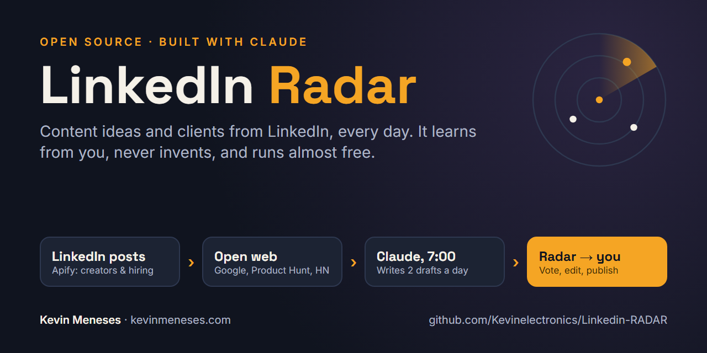

# LinkedIn Radar



A small system that finds **content ideas and clients on LinkedIn** every day, built with Claude.

I'm a technical writer for SaaS and API companies, and LinkedIn is my main channel for finding clients. Every post has two jobs: it's content, and it's how clients find me. Doing that by hand every day doesn't scale, so I built this.

Shared after my talk *From Udemy to 12k YouTube subs* (Projector Global Community, Tenerife). — [Kevin Meneses](https://kevinmeneses.com)

---

## How it works

```
1. LinkedIn posts        2. The open web              3. Claude, every morning      4. Radar → me
   Apify scrapes            Google (SerpApi),            filters, scores and           I vote, edit
   creators, people         Product Hunt, Hacker News,   writes 2 drafts (A/B),        and publish
   and hiring searches      company changelogs           each with its own image
```

1. **LinkedIn posts.** [Apify](https://apify.com?fpr=twi5l8) (actor `harvestapi~linkedin-post-search`) pulls the latest posts from creators I learn from, people I follow as potential clients, and searches like *"hiring technical writer"*. `filter_opps.py` throws out people looking for a job, self-promotion and job boards.
2. **The open web.** Google searches over LinkedIn, plus new launches from the Product Hunt feed, Show HN and company changelogs (`fetch_launches.py`, free sources only).
3. **Claude, at 7:00.** A scheduled Claude task follows `routines/DAILY.md`: it reads the new posts, picks a topic, writes two post drafts (A and B) in proven formats and renders an image for each one with the HTML engine (`render.py`). On Mondays, `routines/WEEKLY.md` builds the opportunities list.
4. **Radar → me.** Everything lands in the Radar app (`app/radar.html`), a Claude artifact with a small database: tabs for *For you*, *Viral ideas*, *Opportunities*, *Calendar*, *Launches* and *Formats*. I vote, edit and publish. Optionally, approved posts are scheduled through [Zernio](https://zernio.link/kevin-meneses) (`zernio.py`, `routines/PUBLISH.md`).

## Three things that make it work

- **It learns from me.** Every like, the version I choose and my "what would you change?" comments update a style profile, and the next drafts follow it.
- **It never invents.** It checks that tools and repos exist, leaves `[your experience here]` blanks for personal stories, and it never posts to LinkedIn on its own.
- **Almost free.** Apify's free plan gives $5 a month, so new posts are only fetched on Mondays and Thursdays. Launches come from free RSS feeds.

## What's in this repo

| Folder | What it is |
|---|---|
| `scripts/` | Python scripts: fetch posts and opportunities (Apify), filter them, collect launches, render images and videos, publish via Zernio |
| `templates/` | HTML templates for post images: flow, sketch, code, chart, versus, list, hub, stack, wheel, landscape, bento, carousel, demo |
| `examples/` | Example specs (and some rendered PNGs) for each template |
| `routines/` | The instructions for the scheduled Claude tasks (daily posts, weekly opportunities, publishing). Written in Spanish, my working language |
| `app/` | The Radar app UI (runs as a Claude artifact; the data lives in its database, not in this file) |
| `config/` | Placeholder config: replace with your own creators, people, companies and brand |

My own data (scraped posts, opportunities, drafts, votes) is not in this repo, and `data/` is git-ignored.

## Setup

1. Python 3.10+ and Node.js. Install the Python packages:
   ```bash
   pip install playwright requests numpy
   playwright install chromium
   ```
2. Set your keys as environment variables (never in the code):
   - `APIFY_TOKEN`: from your [Apify](https://apify.com?fpr=twi5l8) account.
   - `ZERNIO_API_KEY` and `ZERNIO_ACCOUNT_ID`: only if you want to schedule posts with [Zernio](https://zernio.link/kevin-meneses).
3. Edit the files in `config/` with your own list of creators, people and companies, and your name and site in `brand.json` (add your photo as `assets/avatar.jpg` for the image footer).
4. Try it:
   ```bash
   python scripts/fetch_creators.py week        # latest posts from your creators
   python scripts/fetch_opps.py                 # opportunities: people + hiring searches
   python scripts/filter_opps.py                # remove job seekers and self-promotion
   python scripts/fetch_launches.py             # launches from Product Hunt, Show HN, changelogs
   python scripts/render.py examples/list.json out.png
   ```
5. To automate it, create scheduled tasks in Claude that follow the files in `routines/`, pointing them to your own Radar artifact.

## Questions

Find me on [LinkedIn](https://www.linkedin.com/in/kevin-meneses-gonzalez/) or at [kevinmeneses.com](https://kevinmeneses.com).

## License

MIT. Use it, change it and build your own.
